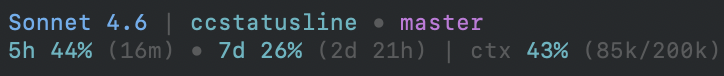

# ccstatusline

A custom Claude Code status line that shows your current model, working folder, git branch, rate-limit usage, and context window pressure.



## What It Shows

**Line 1** — model, effort, account, folder, branch, worktree, PR, session name:
```
Sonnet 4.6 high work  |  myproject  •  main  •  wt my-feature  •  #42 approved  •  my-session
```

Each of effort, account, worktree, PR, and session name appears only when present. The account label shows when `CLAUDE_CONFIG_DIR` is set to something other than `.claude` (`.claude-work` becomes `work`). The PR is a clickable link in terminals that support OSC 8. Rate limits are shared across sessions of the same account: the newest values seen by any session are cached in `$TMPDIR/ccstatusline` and shown by all of them. Context tokens use `context_window.total_input_tokens`, matching the percentage.

**Worktrees** — the folder is where the session lives (`workspace.project_dir`), while the branch comes from the current working directory (`workspace.current_dir`), so it follows `claude --worktree`, the EnterWorktree tool, and a move into a linked worktree. The `wt` segment shows `worktree.name` or, failing that, `workspace.git_worktree`, and is hidden when it matches the folder name, so a session started inside a worktree shows that name once. A Bash `cd` into a folder outside the project is reset after each command, so the status line keeps showing the project folder. To make a `cd` into sibling worktrees stick, add their parent folder to `permissions.additionalDirectories` in settings (or use `/add-dir`).

**Line 2** — rate limits and context usage:
```
5h 34% (3h 22m)  •  7d 12% (5d 8h)  |  ctx 41% (82k/200k)
```

Color coding:
- Model: Opus = amber, Haiku = cyan, others = blue
- Usage percentages: cyan below 50%, yellow at 50–79%, red at 80%+

## Plugin Badges

Line 1 also renders badges from installed Claude Code plugins. Any plugin that ships a `*-statusline.sh` hook has its output appended verbatim at the end of the line, after the session name:

```
Opus 4.8  |  myproject  •  main  •  my-session  •  [CAVEMAN:ULTRA]  •  [PONYTAIL]
```

The status line discovers badges dynamically from `~/.claude/plugins/installed_plugins.json` — no plugin names or colors are hardcoded. Each badge keeps its author's own colors and gating (a plugin prints nothing when inactive), so installing a badge-capable plugin makes its badge appear with zero edits to the script. Badges render in alphabetical order by plugin name.

## Prerequisites

- **Claude Code** — a claude.ai Pro or Max subscription; rate limits come from the status line input
- **jq** — `brew install jq`
- **python3** — included on macOS 12+; otherwise `brew install python3`
- **git** — Xcode CLT or `brew install git`

## Quick Install

```bash
git clone https://github.com/rnzsanchez/ccstatusline.git
cd ccstatusline
bash install.sh
```

Then restart Claude Code.

## Manual Install

1. Copy the scripts to `~/.claude/ccstatusline/`:
   ```bash
   mkdir -p ~/.claude/ccstatusline
   cp ccstatusline/statusline-command.sh ~/.claude/ccstatusline/
   chmod +x ~/.claude/ccstatusline/*.sh
   ```

2. Add the following to `~/.claude/settings.json` (merge with any existing content):
   ```json
   {
     "statusLine": {
       "type": "command",
       "command": "bash ~/.claude/ccstatusline/statusline-command.sh"
     },
     "hooks": {
       "PreToolUse": [
         {
           "matcher": "WebSearch|WebFetch",
           "hooks": [{"type": "command", "command": "echo \"Current date/time: $(date '+%Y-%m-%d %H:%M:%S %Z')\""}]
         }
       ]
     }
   }
   ```

3. Restart Claude Code.

## Configuration Notes

**Rate-limit data** — read from the `rate_limits` field Claude Code passes to the status line on stdin, so each account (each `CLAUDE_CONFIG_DIR`) shows its own usage. The field appears only for claude.ai Pro and Max subscribers, after the first API response in a session.

## Uninstall

```bash
rm -rf ~/.claude/ccstatusline
```

Then remove the `statusLine` key and the ccstatusline hook entries from `~/.claude/settings.json`, and restart Claude Code.
